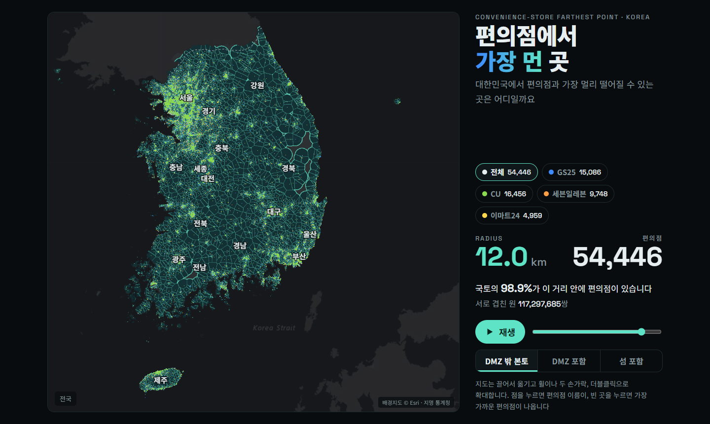

# The Farthest Point from a Convenience Store in Korea

How far can you get from a convenience store in South Korea? Not very far.

This project is a Korean take on the **McFarthest Spot**, the point in the contiguous US that is farthest from any McDonald's. [Stephen Von Worley found it in 2009](https://www.datapointed.net/2009/09/distance-to-nearest-mcdonalds/), roughly 107 miles (172 km) from the nearest McDonald's, and everything.in.math later turned the idea into an animation of growing circles. Korea has no McDonald's on every corner. It has something denser: **54,446 convenience stores**, roughly one for every 950 people. So the question becomes: where in Korea is the farthest point from a convenience store?

The interactive map draws a circle of the same radius around every store and grows it. Where two circles meet, a Voronoi boundary appears. The last spot the circles cover is the answer.



## How dense is it?

Distances are straight-line great-circle distances. Store locations come from the June 2026 release of Korea's Small Enterprise and Market Service commercial-district dataset.

- Half of South Korea's land lies within **2.9 km** of a convenience store.
- **96.8%** of the land lies within **10 km** of one.
- On the mainland outside the DMZ, the farthest you can get is **19.83 km**. The spot is in the mountains of Subi-myeon, Uljin, North Gyeongsang. It sits exactly 19.83 km from three stores in Bonghwa, Yeongyang and Uljin, at the circumcenter where their three circles meet.
- For comparison, the US McFarthest Spot is about 172 km from the nearest McDonald's.

| Stores used | Farthest point, mainland outside the DMZ | Distance | Including islands |
|---|---|---|---|
| All convenience stores | Subi-myeon, Uljin-gun, Gyeongbuk | 19.83 km | Gageodo island, Sinan-gun, 92.79 km |
| GS25 only | Jido-eup, Sinan-gun, Jeonnam | 24.28 km | Heuksan-myeon, Sinan-gun, 102.16 km |
| CU only | Subi-myeon, Yeongyang-gun, Gyeongbuk | 22.65 km | Heuksan-myeon, Sinan-gun, 106.15 km |
| 7-Eleven only | Seoseok-myeon, Hongcheon-gun, Gangwon | 26.63 km | Ulleung-gun, Gyeongbuk, 218.83 km |
| emart24 only | Jaesan-myeon, Bonghwa-gun, Gyeongbuk | 36.97 km | Ulleung-gun, Gyeongbuk, 219.14 km |

If you include the DMZ, the answer moves onto the Military Demarcation Line in Wangjing-myeon, Yeoncheon, at 20.17 km, a place no one can visit.

## Features

- **Play** starts at a 0.1 km radius over Seoul and zooms out to the whole country as the circles grow.
- **Brand filter**: recompute everything with GS25, CU, 7-Eleven or emart24 stores only.
- **Region**: mainland outside the DMZ, mainland including the DMZ, or the whole country with islands.
- **Pan and zoom** with drag, mouse wheel, pinch or double-click.
- **Store names**: hover over a dot to see the store name, click it for the name and neighborhood. Click an empty spot to see the nearest store and its straight-line distance.
- **Answer view**: watch the deciding circles close in until their intersection points meet at the circumcenter.
- The on-page text is in Korean.


## View it

`docs/index.html` is a single self-contained file with all the data inside. Open it in a browser. Base map tiles, fonts and two small libraries load from the internet.

## How it is computed

| Step | Method |
|---|---|
| Distance | Earth as a sphere of radius 6,371.0088 km. Stores become unit vectors in a KD-tree, and a chord length c turns into a great-circle distance d = 2R·asin(c/2) |
| Farthest point | p* = argmax over land of the distance to the nearest store. Only two kinds of candidates exist: Voronoi vertices on land, and points on the boundary where the empty circle spills over the coast or border |
| Voronoi vertices | The convex hull of the stores on the unit sphere is the spherical Delaunay triangulation. Each face's outward normal is the spherical circumcenter of its three stores. This takes 0.3 s for 49,000 points |
| Boundary candidates | The coastline and the DMZ southern limit line, sampled every 20 m, give 300,000 to 840,000 points, each checked with the KD-tree |
| Coverage | About 1.35 million cells of roughly 550 m, each with its nearest-store distance, accumulated with an area weight by latitude |
| Overlapping circles | Two circles of radius r overlap when their centers are at most 2r apart. Counting every pair at large radii takes tens of minutes, so a 4,000-store sample is counted and scaled up |

### Rendering

The first version drew tens of thousands of circles as canvas paths. A single frame took several seconds and the first load took 24 s. The page now picks one of three methods by zoom level.

- **Country scale**: a precomputed distance field at about 556 m resolution. Each pixel stores its nearest-store distance and whether it lies on a Voronoi edge, so a frame only compares `d ≤ r`.
- **Zoomed in**: a screen-space distance field built in JavaScript. Every visible store writes its squared distance and store index into the pixels of its disk. A pixel's nearest store always lies in that store's Voronoi cell, so each disk only needs to reach the radius of its cell. The work stays at a few times the screen area no matter how large the radius gets.
- **Answer view**: a 640×512 exact great-circle distance field precomputed for each brand and region.

On the same machine, the first screen went from 24 s to 0.7 s and frames from up to 1 s to 30 to 100 ms. The actual bottlenecks were:

- A `closePath()` call per polygon across 49,000 polygons cost 22 s.
- Erasing the sea every frame with a 26,000-vertex coastline path.
- Filling tens of thousands of small circles as GPU paths.

## Rebuild

Requires Python 3.13 with numpy, scipy and shapely.

```sh
python src/fetch_data.py     # store data (~350 MB) and boundaries → data/
python src/extract.py        # convenience stores only → data/stores.csv
python src/compute.py        # country distance field for all stores → out/field.bin, out/result.json
python src/compute_sets.py   # farthest points, coverage and answer fields per brand (~2 min)
python src/fields.py         # pack the country field → out/fields.js
python src/build_data.py     # stores, coastline, place names, results → out/page_data.js
python src/build_page.py     # one file → out/mcfarthest-kr.html
cp out/mcfarthest-kr.html docs/index.html
```

## Files

| Path | Contents |
|---|---|
| `src/page.html` | The page source, styles and scripts |
| `src/brands.py` | Store name → brand, including stores registered under the operating company's name |
| `src/compute.py`, `src/compute_sets.py` | Farthest points and coverage |
| `src/fields.py`, `src/build_data.py`, `src/build_page.py` | Packing data for the page |
| `data/stores.csv` | The 54,446 convenience stores extracted from the source data |
| `docs/index.html` | The finished page |

## Limitations

- The store list follows the source dataset's business categories. A few non-chain shops classified as convenience stores are included, and unregistered stores are missing. No store on Heuksando island is classified as a convenience store, so Gageodo's nearest store ends up on Jindo.
- Brands are assigned from store names, so counts may differ slightly from official franchise numbers.
- Administrative boundaries are from 2013, so newer reclaimed land and renamed districts are not reflected.
- In zoomed-in views, circles are drawn as plane circles in the map projection, so east–west extents can be off by up to 3 to 4%. The reported results and the country and answer views use exact great-circle distances.
- All distances are straight lines. By road it is much farther.

## Sources

- Store locations: [Small Enterprise and Market Service, commercial district data](https://www.data.go.kr/data/15083033/fileData.do), Public Data Portal of Korea
- Administrative boundaries: Statistics Korea 2013, via [southkorea/southkorea-maps](https://github.com/southkorea/southkorea-maps)
- DMZ southern limit line: [Natural Earth](https://www.naturalearthdata.com/) 10m
- Base map: Esri World Dark Gray Base
- Libraries: [d3-delaunay](https://github.com/d3/d3-delaunay), [KaTeX](https://katex.org/)
- Inspiration: Stephen Von Worley's McFarthest Spot and the McFarthest point animation by everything.in.math
