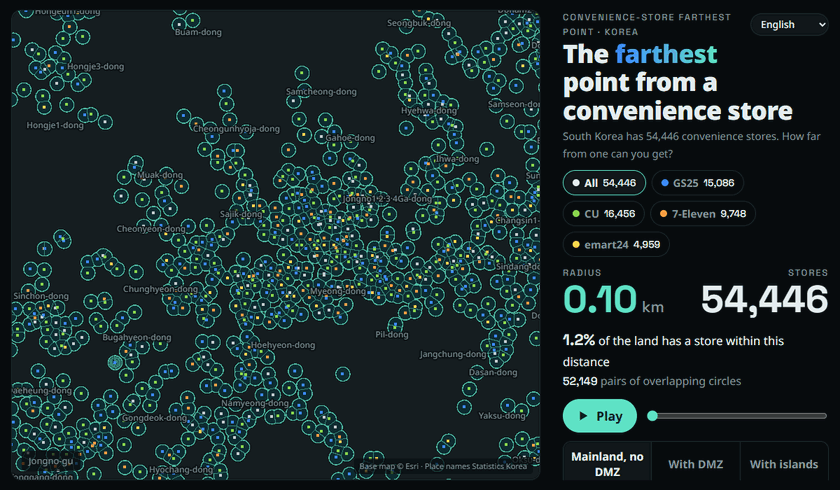
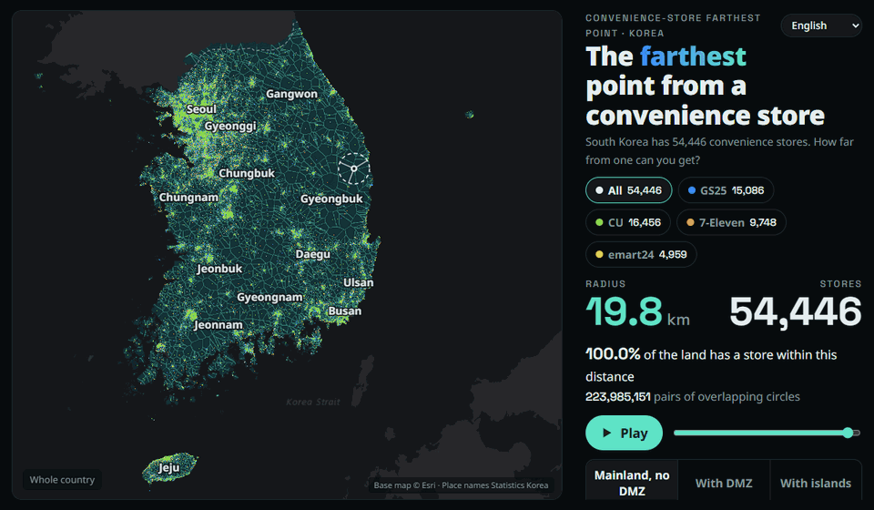
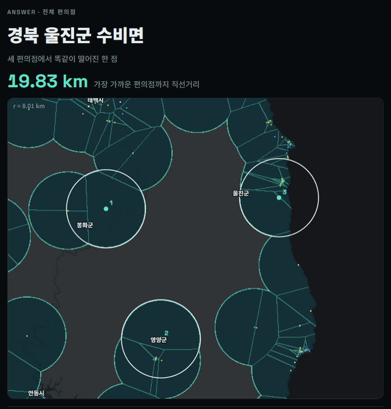
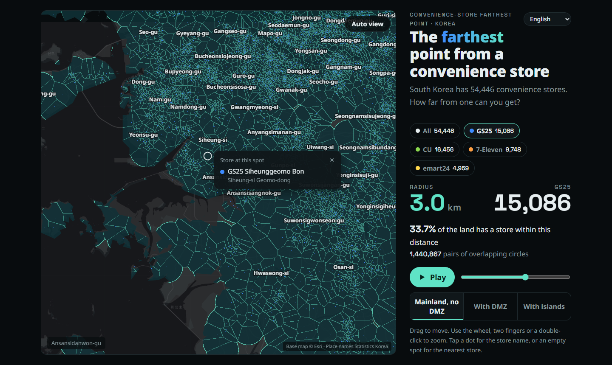

# The Farthest Point from a Convenience Store in Korea

How far can you get from a convenience store in South Korea? Not very far.



This is a hobby toy project, built with [Claude](https://claude.com/claude-code).

It is a Korean take on the **McFarthest Spot**, the point in the contiguous US that is farthest from any McDonald's. [Stephen Von Worley found it in 2009](https://www.datapointed.net/2009/09/distance-to-nearest-mcdonalds/), roughly 107 miles (172 km) from the nearest McDonald's, and everything.in.math later turned the idea into an animation of growing circles. Korea does not have a McDonald's on every corner. It has something far denser: **54,446 convenience stores**, about one for every 950 people. So the question becomes: where in Korea is the farthest point from a convenience store, and how densely do the stores cover the country?

The map draws a circle of the same radius around every store and grows it. Where two circles meet, a Voronoi boundary appears. The last spot left uncovered is the answer.

## How dense is it?

All distances are straight-line great-circle distances. Store locations come from the June 2026 release of Korea's commercial district dataset.

**The whole country** (mainland outside the DMZ, all convenience stores):

| Radius | 1 km | 2 km | 3 km | 5 km | 10 km | 19.83 km |
|---|---:|---:|---:|---:|---:|---:|
| Land with a store within that distance | 18% | 36% | 52% | 75% | 97% | 100% |

- Half of the land is within **2.9 km** of a convenience store, 80% within **5.6 km**, and 99% within **12.2 km**.
- The farthest you can get is **19.83 km**, in the mountains of Subi-myeon, Uljin, North Gyeongsang. That spot is exactly 19.83 km from three stores in Bonghwa, Yeongyang and Uljin, at the circumcenter where their three circles meet.
- The US McFarthest Spot is about 172 km from the nearest McDonald's, almost nine times as far.

**By province.** In Seoul, 92% of the land has a convenience store within 1 km, and the typical spot is 180 m from one. The farthest point in all of Seoul is 3 km from a store.

| Province | Land km² | Stores | Stores per km² | Within 500 m | Within 1 km | Within 2 km | Within 5 km | Median distance | Farthest point |
|---|---:|---:|---:|---:|---:|---:|---:|---:|---:|
| Seoul | 606 | 9,418 | 15.54 | 80% | 92% | 99% | 100% | 180 m | 3.0 km |
| Busan | 784 | 2,751 | 3.51 | 42% | 68% | 90% | 100% | 630 m | 4.4 km |
| Incheon | 1,179 | 2,955 | 2.51 | 30% | 53% | 79% | 94% | 920 m | 24.4 km |
| Gyeonggi | 10,369 | 14,751 | 1.42 | 25% | 48% | 74% | 94% | 1.06 km | 20.1 km |
| Gwangju | 499 | 1,356 | 2.72 | 33% | 47% | 71% | 98% | 1.12 km | 6.5 km |
| Daejeon | 540 | 1,459 | 2.70 | 30% | 46% | 68% | 99% | 1.17 km | 5.7 km |
| Daegu | 880 | 2,022 | 2.30 | 28% | 44% | 66% | 94% | 1.23 km | 7.7 km |
| Jeju | 1,889 | 1,218 | 0.65 | 17% | 37% | 64% | 90% | 1.38 km | 9.6 km |
| Sejong | 466 | 322 | 0.69 | 16% | 35% | 66% | 100% | 1.45 km | 5.6 km |
| Ulsan | 1,068 | 1,124 | 1.05 | 17% | 34% | 66% | 99% | 1.46 km | 6.8 km |
| Chungnam | 8,310 | 2,843 | 0.34 | 9% | 21% | 46% | 90% | 2.19 km | 24.8 km |
| Gyeongnam | 10,589 | 3,239 | 0.31 | 7% | 16% | 35% | 77% | 2.86 km | 21.9 km |
| Chungbuk | 7,406 | 1,997 | 0.27 | 6% | 15% | 34% | 80% | 2.88 km | 11.2 km |
| Jeonbuk | 8,011 | 1,748 | 0.22 | 5% | 12% | 30% | 74% | 3.19 km | 47.6 km |
| Jeonnam | 12,607 | 1,695 | 0.13 | 4% | 10% | 25% | 73% | 3.37 km | 92.7 km |
| Gyeongbuk | 19,023 | 2,738 | 0.14 | 4% | 9% | 22% | 61% | 4.04 km | 89.3 km |
| Gangwon | 16,919 | 2,358 | 0.14 | 3% | 8% | 20% | 60% | 4.18 km | 18.5 km |

The province figures use a 222 m grid over the 2013 province boundaries, and count stores whose coordinates fall inside each boundary. The farthest points in Jeonnam and Gyeongbuk are islands: Gageodo and Dokdo.

**By brand.** Each brand alone leaves bigger gaps.



| Stores used | Farthest point, mainland outside the DMZ | Distance | 5 km coverage | Including islands |
|---|---|---:|---:|---|
| All convenience stores | Subi-myeon, Uljin-gun, Gyeongbuk | 19.83 km | 75% | Gageodo, Sinan-gun, 92.79 km |
| CU only | Subi-myeon, Yeongyang-gun, Gyeongbuk | 22.65 km | 63% | Heuksan-myeon, Sinan-gun, 106.15 km |
| GS25 only | Jido-eup, Sinan-gun, Jeonnam | 24.28 km | 54% | Heuksan-myeon, Sinan-gun, 102.16 km |
| 7-Eleven only | Seoseok-myeon, Hongcheon-gun, Gangwon | 26.63 km | 50% | Ulleung-gun, Gyeongbuk, 218.83 km |
| emart24 only | Jaesan-myeon, Bonghwa-gun, Gyeongbuk | 36.97 km | 45% | Ulleung-gun, Gyeongbuk, 219.14 km |

If you include the DMZ, the answer moves onto the Military Demarcation Line in Wangjing-myeon, Yeoncheon, at 20.17 km, a place no one can visit.

## The moment of the answer

In the answer view, the three deciding circles close in. Their intersection points slide along the perpendicular bisectors and meet at a single point, the circumcenter of the three stores.



The math behind every step is written up in **[docs/MATH.md](docs/MATH.md)**: great-circle distance, circle intersections, Voronoi cells, spherical circumcenters from a convex hull, why the answer must be a Voronoi vertex or a boundary point, the coverage function, and the cell-radius bound that keeps the rendering fast.

## Features

- **Play** starts at a 0.1 km radius over Seoul and zooms out to the whole country as the circles grow.
- **Brand filter**: recompute everything with GS25, CU, 7-Eleven or emart24 stores only.
- **Region**: mainland outside the DMZ, mainland including the DMZ, or the whole country with islands.
- **Pan and zoom** with drag, mouse wheel, pinch or double-click.
- **Store names**: hover over a dot to see the store name, click it for the name and neighborhood. Click an empty spot to see the nearest store and its straight-line distance.
- The on-page text is in Korean.



## Run it

`docs/index.html` is a single self-contained file with all the data inside. Open it in a browser. Base map tiles, fonts and two small libraries load from the internet.

## How it works, briefly

| Step | Method |
|---|---|
| Distance | Earth as a sphere of radius 6,371.0088 km. Stores become 3D unit vectors in a KD-tree, so nearest-store queries are exact on the sphere |
| Farthest point | The center of the largest empty circle. Candidates are the Voronoi vertices on land and points on the coastline or DMZ line |
| Voronoi vertices | The convex hull of the stores on the unit sphere gives the spherical Delaunay triangulation; each face normal is a circumcenter. 0.3 s for 49,000 points |
| Coverage | 1.35 million cells of about 556 m with their nearest-store distance, weighted by area |
| Rendering | A precomputed distance field at country scale, a screen-space distance field when zoomed in, and exact precomputed fields for the answer view |

The first version drew tens of thousands of circles as canvas paths, and the first load took 24 s. After profiling, the first screen takes about 0.7 s and frames take 30 to 100 ms. The single biggest cost was a `closePath()` call per polygon, which took 22 s across 49,000 polygons.

## Rebuild

Requires Python 3.13 with numpy, scipy, shapely and Pillow.

```sh
python src/fetch_data.py     # store data (~350 MB) and boundaries → data/
python src/extract.py        # convenience stores only → data/stores.csv
python src/compute.py        # country distance field for all stores
python src/compute_sets.py   # farthest points, coverage and answer fields per brand (~2 min)
python src/fields.py         # pack the country field
python src/build_data.py     # stores, coastline, place names and results for the page
python src/build_page.py     # one file → out/mcfarthest-kr.html
cp out/mcfarthest-kr.html docs/index.html

python tools/region_stats.py # province table above
python tools/make_gifs.py    # the GIFs in this README, captured with headless Chrome
```

## Files

| Path | Contents |
|---|---|
| `src/page.html` | The page source, styles and scripts |
| `src/brands.py` | Store name → brand, including stores registered under the operating company's name |
| `src/compute.py`, `src/compute_sets.py` | Farthest points and coverage |
| `src/fields.py`, `src/build_data.py`, `src/build_page.py` | Packing data for the page |
| `tools/region_stats.py`, `tools/make_gifs.py` | Province statistics and README animations |
| `data/stores.csv` | The 54,446 convenience stores extracted from the source data |
| `docs/index.html` | The finished page |
| `docs/MATH.md` | The math, step by step |

## Limitations

- The store list follows the source dataset's business categories. A few non-chain shops classified as convenience stores are included, and unregistered stores are missing. No store on Heuksando island is classified as a convenience store, so Gageodo's nearest store ends up on Jindo.
- Brands are assigned from store names, so counts may differ slightly from official franchise numbers.
- Administrative boundaries are from 2013, so newer reclaimed land and renamed districts are not reflected. About 450 stores on land outside those boundaries are not counted in the province table.
- In zoomed-in views, circles are drawn as plane circles in the map projection, so east–west extents can be off by up to 3 to 4%. The reported results and the country and answer views use exact great-circle distances.
- All distances are straight lines. By road it is much farther.

## Sources

- Store locations: [Small Enterprise and Market Service, commercial district data](https://www.data.go.kr/data/15083033/fileData.do), Public Data Portal of Korea
- Administrative boundaries: Statistics Korea 2013, via [southkorea/southkorea-maps](https://github.com/southkorea/southkorea-maps)
- DMZ southern limit line: [Natural Earth](https://www.naturalearthdata.com/) 10m
- Base map: Esri World Dark Gray Base
- Libraries: [d3-delaunay](https://github.com/d3/d3-delaunay), [KaTeX](https://katex.org/)
- Inspiration: Stephen Von Worley's McFarthest Spot and the McFarthest point animation by everything.in.math
